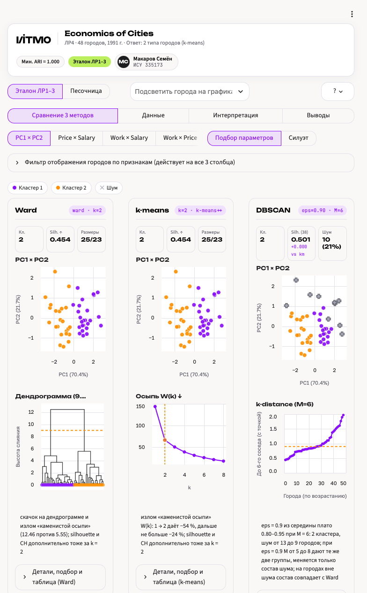
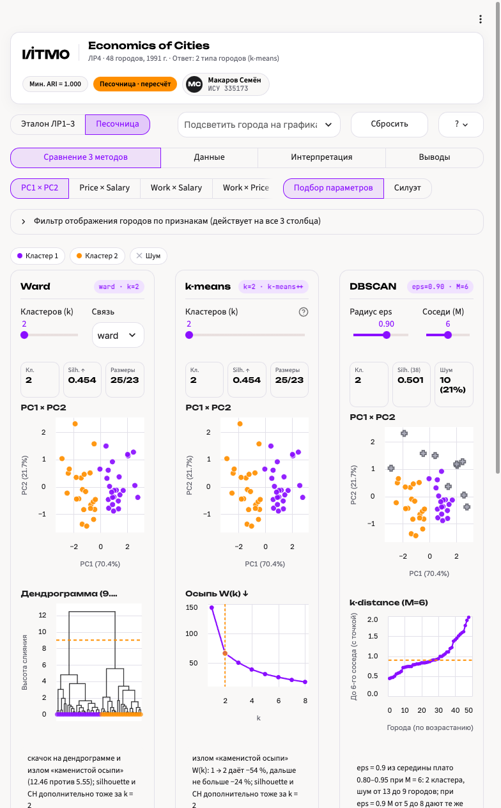

# Анализ данных на Python: лабораторные работы

Университет ИТМО, курс «Анализ данных на Python».  
**Автор:** Макаров Семён, ИСУ 335173.  
**Вариант 2:** *Economics of Cities* (48 городов мира, 1991 г.: рабочие часы `Work`, индекс цен `Price`, индекс зарплаты `Salary`).

## Состав репозитория

| ЛР | Тема | Материалы | Ключевой результат |
|---|---|---|---|
| **1** | Иерархический кластерный анализ (Ward) | [lab01_hierarchical.ipynb](lab01/lab01_hierarchical.ipynb) [](https://colab.research.google.com/github/makaroveo/itmo-python-data-analysis/blob/main/lab01/lab01_hierarchical.ipynb) | `k = 2`, размеры `25 / 23`, Silhouette `0.454`, CH `53.7`, DB `0.844` |
| **2–3** | Методы k-средних и DBSCAN | [lab02_03_kmeans_dbscan.ipynb](lab02_03/lab02_03_kmeans_dbscan.ipynb) [](https://colab.research.google.com/github/makaroveo/itmo-python-data-analysis/blob/main/lab02_03/lab02_03_kmeans_dbscan.ipynb) | **k-means:** `k = 2`, `25 / 23`, Silhouette `0.454` (`ARI = 1.000` с Ward)<br>**DBSCAN:** `eps = 0.90`, `M = 6`, `18 / 20` + шум `10` (`21%`), Silhouette `0.501` по 38 городам |
| **4** | Интерактивный аналитический дашборд | [lab04/app.py](lab04/app.py), [lab04/model.py](lab04/model.py), [lab04/charts.py](lab04/charts.py) | Streamlit + Altair в стиле ИТМО (`ds.itmo.ru`): 3 столбца методов рядом, режимы «Эталон ЛР1–3» и «Песочница», 17 тестов |

## Дашборд ЛР4

Дашборд объединяет результаты всех трёх алгоритмов и позволяет как просматривать зафиксированные результаты ноутбуков (**Эталон ЛР1–3**), так и менять параметры в реальном времени (**Песочница**: `k` и метод связи для Ward, `k` для k-means, `eps` и `min_samples` для DBSCAN) с мгновенным пересчётом разбиений, метрик, дендрограммы, силуэт-профилей и расхождений с эталоном.

- **Сравнение 3 методов** — главный экран с тремя столбцами (`Ward | k-means | DBSCAN`) в единых осях и общей палитре, локальными параметрами, сводной таблицей метрик, матрицей совпадений `A × B`, ARI и тепловой картой `eps × M`.
- **Данные** — паспорт набора, вклад признаков в дисперсию до и после z-стандартизации, гистограммы, корреляции и описательная статистика.
- **Интерпретация** — профили кластеров по z-оценкам, динамические карточки групп (`k = 2…8`), распределения признаков и сравнение пар `A vs B`.
- **Выводы** — обоснование базового решения (`k = 2`, `k-means`) и сводка изменений песочницы относительно эталона.

| Сравнение 3 методов (Эталон ЛР1–3) | Песочница (живой пересчёт) |
|---|---|
|  |  |

## Запуск и проверка

```sh
python -m venv .venv && source .venv/bin/activate
pip install -r requirements.txt
```

Запуск ноутбуков ЛР1–3:

```sh
jupyter notebook
```

Запуск дашборда ЛР4:

```sh
streamlit run lab04/app.py --server.address 127.0.0.1
```

Запуск автотестов дашборда:

```sh
python -m unittest discover -s lab04 -v
```
